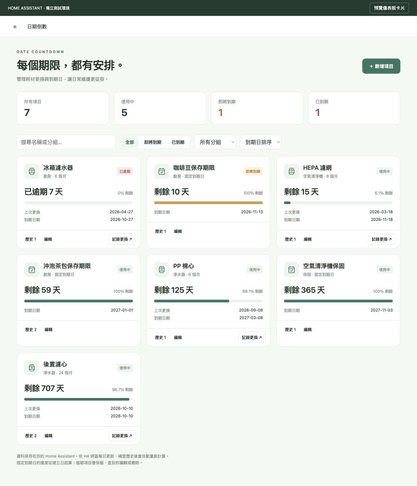
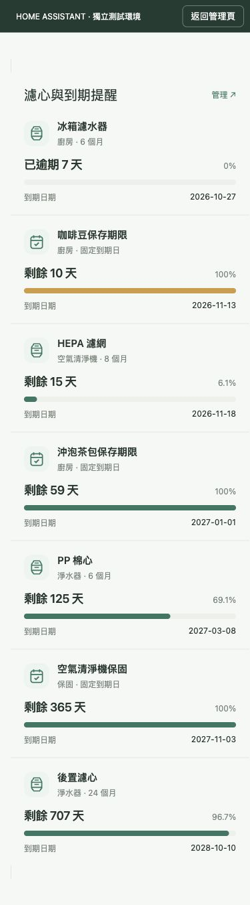

# Date Countdown 日期倒數

在 Home Assistant 集中管理耗材壽命、固定到期日與更換歷史，並用專屬儀表板卡片查看剩餘進度。資料保存在自己的 HA，不需要額外雲端帳號。

## 三個部分

| 部分 | 功能 |
| --- | --- |
| 資料 | 更換日期、天／月／年的壽命、固定到期日、更換歷史與備註 |
| 管理頁 | HA 側邊欄「日期倒數」：新增、編輯、刪除、分組、搜尋、篩選及補登歷史 |
| 儀表板卡片 | 名稱、剩餘天數、百分比進度條、到期日期，以及即將到期／逾期顏色 |



畫面來自獨立 HA 測試環境，內容為示範資料。

## 透過 HACS 安裝

1. 在 HA 開啟 HACS，右上角選單選「自訂儲存庫」。
2. 輸入 `https://github.com/MCChang-cmyk/ha-date-countdown`，類型選 **Integration（整合）**。
3. 搜尋 **Date Countdown** 並下載，重新啟動 HA。
4. 前往「設定 → 裝置與服務 → 新增整合」，搜尋 **Date Countdown**，建立第一個項目。
5. 重新整理瀏覽器，側邊欄會出現 **日期倒數**。後續可直接在管理頁新增項目。

需要先安裝 [HACS](https://www.hacs.xyz/docs/use/download/download/)。這是 HACS 自訂儲存庫，尚未列入預設清單。

也可將 `custom_components/date_countdown` 複製到 HA 的 `/config/custom_components/date_countdown` 後重新啟動。

## 從 0.1.0 升級

1. 先建立 HA 備份，包含此整合設定。
2. 在 HACS 更新或重新下載 Date Countdown，選擇最新版本／main。
3. **重新啟動 HA，再重新整理瀏覽器**。手機 App 可關閉並重新開啟。
4. 原有項目會出現在「日期倒數」管理頁。

升級保留既有 config entry、裝置與實體識別碼。原有更換日期會轉成一筆「初始紀錄」，原日期與壽命仍會保留。升級之前未記錄的歷次更換無法自動還原，可在歷史中補登。

資料結構版本已升級為 2；0.1.0 不支援新版資料，若需要回退，請還原升級前的 HA 備份。

## 管理項目

### 耗材壽命

輸入名稱、分組（選填）、上次更換日期、使用期限與提醒天數。

- 到期日由「更換日期＋期限」計算。
- 天是固定日數；月／年按日曆計算，月底縮至目標月最後一天，例如 1/31 加一個月為 2/28。
- 「記錄更換」可填今天或補登過去日期，並留下最多 2000 字備註。
- 最新一筆更換紀錄決定目前倒數。補登較早的紀錄不會把目前倒數重設。
- 可修正、刪除誤登紀錄；刪除最新紀錄會回到上一筆，至少需保留一筆更換紀錄。
- 編輯項目中的「上次更換日期」會修正最新一筆紀錄；「今天已更換」按鈕則會新增紀錄。
- 新的更換紀錄不能設成未來日期。從 0.1.0 升級的既有未來日期會保留，請於管理頁確認或修正。

### 固定到期日

直接指定日期，適合食品、保固、證照等。

- 保留建立及每次到期日變更紀錄，包含前後到期日。
- 不提供「記錄更換」或更換日期實體。
- 百分比以建立日到目前到期日為區間；若到期日已過或就是建立當天，顯示 0%。
- 修改到期日保留原建立日，因此百分比的計算區間也會跟著調整。

既有項目不能直接切換類型，請新增正確類型的項目。

### 狀態與提醒

- 剩餘天數依 HA 的本地日期計算，每日午夜更新。
- 到期日是 0 天，逾期保留負數；進度條限制在 0–100%。
- 提醒天數預設 14 天，可每項設定。剩餘天數小於等於門檻時，管理頁與專屬卡片改為提醒顏色。
- 通知由 HA 自動化設定；本整合不會主動發送推播。
- 管理頁與管理 API 限管理員使用。一般使用者可查看有權限的原生實體及儀表板卡片。
- 刪除項目會移除其整合項目、裝置／實體與歷史；管理頁會先要求確認。
- 若其他頁面已修改同一項目，會拒絕覆寫並提示重新開啟編輯。

## 加入儀表板卡片

整合會自動載入前端模組。更新後重新整理瀏覽器，在儀表板「新增卡片」中搜尋 **日期倒數**，可用介面勾選項目與設定排序。

也可用手動卡片：

```yaml
type: custom:date-countdown-card
title: 濾心壽命
```

不指定 `entities` 或設為空陣列時，顯示所有此整合的「剩餘天數」實體。也可選擇特定項目：

```yaml
type: custom:date-countdown-card
title: 淨水器濾心
entities:
  - sensor.filter_post_days_remaining
  - sensor.filter_pp_days_remaining
sort: due
```

實體 ID 請改成裝置頁的實際 ID。可用 `sort: name` 按名稱排序，或加上 `group: 淨水器` 篩選分組（分組可在 YAML 設定）。點擊項目開啟原生實體詳情；管理員另有「管理」連結。

卡片不會讀取完整更換歷史。如果出現「Custom element doesn't exist」，先確認整合成功載入並重新整理；必要時在儀表板資源中新增 **JavaScript Module**：

```text
/date_countdown_static/date-countdown.js?v=0.2.0
```

通常不需要手動新增資源，請避免同時保留多個舊版網址。



## 原生實體與既有 bar-card

| 實體 | 耗材壽命 | 固定到期日 |
| --- | --- | --- |
| 剩餘天數 sensor | ✓ | ✓ |
| 剩餘壽命百分比 sensor | ✓ | ✓ |
| 到期日期 sensor | ✓ | ✓ |
| 已到期 binary_sensor | ✓ | ✓ |
| 可編輯的更換日期 date | ✓ | — |
| 今天已更換 button | ✓ | — |

保留原生實體，所以既有 bar-card 及通知自動化仍可使用。剩餘天數實體附帶名稱、分組、類型、期限、提醒門檻、到期日與百分比，但**不包含更換歷史與備註**。

## 資料儲存與備份

- 每個項目是一個 HA config entry，包含自己的設定與歷史，透過 HA 官方設定儲存機制保存（`.storage/core.config_entries`）。
- 管理頁、選項流程、日期實體與更換按鈕使用同一份資料。
- 歷史不依賴 Recorder，所以不會因一般歷史清理而消失；HA 完整備份應包含整合設定。
- 請透過介面修改，不要直接編輯 `.storage`。GitHub 只存程式碼，不會接收你的項目資料。

## 驗證與開發

已於 **Home Assistant 2026.10.4／Python 3.14** 的獨立環境驗證；尚未在使用者的 HA 主機上驗證。

```sh
python3.14 -m venv .venv
.venv/bin/python -m pip install -r requirements-test.txt
.venv/bin/python -m pytest
node --check custom_components/date_countdown/frontend/date-countdown.js
```

22 項測試涵蓋日期邊界、歷史操作、舊版資料轉換、實體服務、選項更新、重新載入、HA 停止後新實例讀取儲存資料、管理 API、資料版本衝突與管理員權限。執行 HA 測試時會使用本機 18329 連線埠；請勿同時執行多組測試。

管理頁的新增、編輯、補登歷史及卡片顯示另以瀏覽器連接測試用 HA 驗證；桌面與 390px 手機尺寸均已檢查。每日午夜排程由 HA 的本地時間追蹤機制處理，尚未做跨時區／DST 的長時間實機測試。
